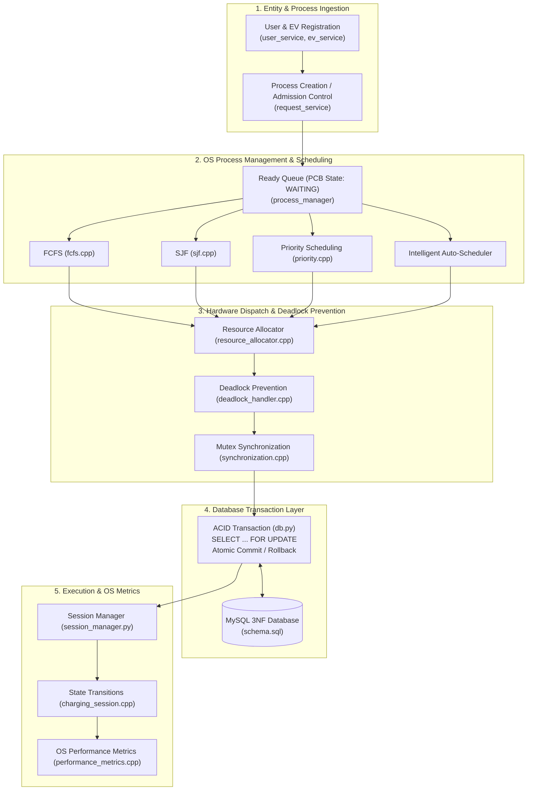

# DBOS: EV Charging Queue & Resource Management System

[](https://www.python.org/)
[](https://isocpp.org/)
[](https://www.mysql.com/)
[](#)

A hybrid **Database Operating System (DBOS)** that bridges Operating System principles (CPU scheduling, Process Control Blocks, concurrency synchronization, and deadlock prevention) with Database Management System guarantees (3NF relational modeling, ACID transactions, pessimistic row locking with `SELECT ... FOR UPDATE`, and audit logging) to resolve electric vehicle (EV) charging congestion, charger socket contention, and grid power limits.

---

## Architecture Overview



---

## Team Roles & Contributions

### 1. Devansh Agarwal
* **DBOS System Architecture & Schema:** Designed the end-to-end architecture and normalized 9-table Third Normal Form (3NF) relational data model with primary/foreign key constraints and validation checks.
* **Process Control Block (PCB):** Modeled the OS Process structure, four-stage lifecycle (`WAITING`, `READY`, `RUNNING`, `COMPLETED`), and OS Burst Time estimation formula ($BT = \frac{\text{Required Energy}}{\text{Requested Power}}$).
* **CPU Scheduling Engines:** Implemented FCFS, Non-Preemptive SJF, and battery SoC-based Priority Scheduling in C++, alongside the adaptive auto-scheduler and metrics evaluation.

### 2. Aarushi Malik
* **ACID Transaction Protocols:** Implemented strict transactional execution controls (`BEGIN`, `COMMIT`, `ROLLBACK`) across all database state transitions.
* **Pessimistic Concurrency Control:** Designed row-level pessimistic locking via `SELECT ... FOR UPDATE` on `CHARGING_REQUEST`, `CHARGER`, `STATION`, `RESOURCE_ALLOCATION`, and `CHARGING_SESSION` to prevent race conditions during concurrent allocations.
* **Contention & Deadlock Management:** Implemented atomic rollback handlers on hardware contention and transactional-layer Hold-and-Wait deadlock elimination.

### 3. Nitin Chauhan
* **Physical Resource Modeling:** Modeled physical constraints for charging stations (grid total power capacity, dynamic remaining power) and discrete charging ports (connector types, kW capacity).
* **Concurrency & Synchronization:** Implemented OS `std::mutex` locks to guard shared station power and Counting Semaphore mechanics for charger port sockets in C++.
* **Spatial Compatibility & Audit Logging:** Formulated coordinate-based location accessibility (`latitude`, `longitude`), hardware connector compatibility filtering (`CCS2`, `Type 2`), and structured event auditing in the `SYSTEM_LOG` table.

---

## Key Features & OS / DBMS Implementations

### 1. Process Control Block (PCB) & Process Lifecycle
Every incoming EV charging request is treated as an OS Process:
* **PID:** Unique `request_id`.
* **State Transition Lifecycle:**
  $$\text{WAITING} \longrightarrow \text{READY} \longrightarrow \text{RUNNING} \longrightarrow \text{COMPLETED}$$
  *(or $\text{REJECTED}$ if power exceeds maximum station hardware limits).*
* **Arrival Time ($AT$):** Timestamp when request entered the queue.
* **Burst Time ($BT$):** Estimated service duration calculated dynamically:
  $$\text{Burst Time (hours)} = \frac{\text{Required Energy (kWh)}}{\text{Charger Power (kW)}}$$

### 2. CPU Scheduling Algorithms
* **First-Come, First-Served (FCFS):** Dispatches processes strictly by Arrival Time ($AT$).
* **Non-Preemptive Shortest Job First (SJF):** Dispatches the request with the smallest service duration ($BT$), minimizing system average waiting time.
* **Non-Preemptive Priority Scheduling:** Implements a two-tier priority model:
  * **Tier 1 (High Priority):** Pre-booked reservations (`is_reserved = TRUE`) and emergency vehicles with critical battery ($\text{SoC} \le 20\%$).
  * **Tier 2 (Standard Priority):** Walk-in vehicles prioritized by lowest battery SoC.
* **Intelligent Adaptive Auto-Scheduler:** Evaluates queue telemetry in real time:
  * **Priority Mode:** Automatically triggered if any waiting EV has a pre-booked reservation or critical battery ($\text{SoC} \le 20\%$).
  * **SJF Congestion Mode:** If waiting queue size $\ge 3$ vehicles without reservations.
  * **FCFS Normal Mode:** Under light load without reservations or critical emergencies.

### 3. Concurrency, Mutexes & Deadlock Prevention
* **Mutual Exclusion (`std::mutex`):** Protects critical sections to prevent race conditions where multiple requests attempt to claim the same charger or exceed station remaining power.
* **Elimination of Circular Wait:** Imposes a strict global linear resource ordering:
  $$\text{Station Power (Resource Class 1)} \prec \text{Charger Port (Resource Class 2)}$$
  Requests acquire station power before claiming the port, rendering graph cycles impossible.
* **Elimination of Hold and Wait:** Enforces an **All-or-Nothing** atomic allocation policy: if both the charger and sufficient station power are available, both are locked together; otherwise, zero resources are held and the process remains in `WAITING`.

### 4. ACID Transactions & Row-Level Locking
* Every hardware allocation executes inside an isolated transaction with `SELECT ... FOR UPDATE`.
* If a station or charger becomes occupied during verification, the transaction executes an immediate `ROLLBACK`, logs `TRANSACTION_ROLLBACK` in `SYSTEM_LOG`, and retains the process in `WAITING` without corrupting state.

### 5. OS Performance Metrics
Compares algorithms side-by-side using standard operating system turnaround and waiting metrics:
* **Turnaround Time ($TAT$):**
  $$TAT = CT - AT$$
* **Waiting Time ($WT$):**
  $$WT = TAT - BT$$
* Outputs Average Waiting Time and Average Turnaround Time across FCFS, SJF, and Priority.

---

## Relational Data Model (3NF)

The database schema (`dbos_ev`) is normalized to Third Normal Form (3NF) across 9 tables:

1. **`APP_USER`**: EV owners (User ID, username, email, phone).
2. **`LOCATION`**: Geographic coordinates (`latitude`, `longitude`, location name).
3. **`EV`**: Electric vehicles (Model, battery capacity, current SoC %, location FK).
4. **`STATION`**: Charging stations (Total grid power, location FK, status).
5. **`CHARGER`**: Ports/sockets (Connector type, power capacity, status, station FK).
6. **`CHARGING_REQUEST`**: OS Process records (Arrival time, energy, power, SoC, is_reserved flag, process state).
7. **`RESOURCE_ALLOCATION`**: Active hardware claims (Allocated power, timestamps, status).
8. **`CHARGING_SESSION`**: Real-time session execution (Energy consumed, duration, status).
9. **`SYSTEM_LOG`**: Immutable system audit trail (Event types: `PROCESS_CREATED`, `SCHEDULING`, `ALLOCATION_SUCCESS`, `CHARGING_STARTED`, `CHARGING_COMPLETED`, `RESOURCE_RELEASED`, `TRANSACTION_ROLLBACK`).

---

## Project Structure

```text
DBOS_EV PROJECT/
│
├── database/
│   ├── schema.sql                   # 9-table 3NF schema with foreign keys and checks
│   └── sample_data.sql              # Realistic seed data for stations, chargers, and EVs
│
├── backend/
│   ├── config.py                    # MySQL connection parameters
│   ├── db.py                        # Database access layer, transactions & row locks
│   ├── test_connection.py           # Database connection & schema verification script
│   ├── main.py                      # Interactive terminal CLI menu (15 options)
│   │
│   ├── user_service.py              # User registration and query operations
│   ├── ev_service.py                # EV registration, specs & location mapping
│   ├── request_service.py           # Admission control, process creation & burst time calc
│   │
│   ├── process_manager.py           # Python scheduler bridge & Adaptive Scheduler heuristic
│   ├── process_manager.cpp          # C++ Ready Queue / PCB display engine
│   ├── fcfs.cpp                     # C++ First-Come, First-Served engine
│   ├── sjf.cpp                      # C++ Shortest Job First engine
│   ├── priority.cpp                 # C++ SoC-based Priority Scheduling engine
│   │
│   ├── resource_allocator.py        # Python dispatch bridge & atomic commit handler
│   ├── resource_allocator.cpp       # C++ hardware feasibility check & power deduction
│   │
│   ├── deadlock_handler.py          # Python deadlock prevention bridge
│   ├── deadlock_handler.cpp         # C++ Deadlock Prevention engine (Resource Ordering)
│   ├── synchronization.cpp          # C++ Mutex & multi-threaded concurrency simulation
│   │
│   ├── session_manager.py           # Charging session lifecycle & auto-simulation engine
│   ├── charging_session.cpp         # C++ session state machine validator
│   └── performance_metrics.cpp      # C++ OS comparative metrics calculation (TAT, WT)
│
├── requirements.txt                 # Python dependencies
└── README.md                        # Documentation
```

---

## Getting Started

### Prerequisites
* **Python 3.10+**
* **MySQL Server 8.0+**
* **C++ Compiler (`g++` / MinGW)**

### 1. Clone the Repository
```bash
git clone https://github.com/<your-username>/dbos-ev-queue-management.git
cd dbos-ev-queue-management
```

### 2. Install Python Dependencies
```bash
pip install -r requirements.txt
```

### 3. Setup the Database
1. Open your MySQL client and run the schema and seed scripts:
   ```sql
   SOURCE database/schema.sql;
   SOURCE database/sample_data.sql;
   ```
2. Configure credentials in `.env` (or set environment variables):
   ```env
   DB_HOST=localhost
   DB_PORT=3306
   DB_USER=root
   DB_PASSWORD=your_password
   DB_NAME=dbos_ev
   ```
3. Test connection:
   ```bash
   python backend/test_connection.py
   ```

### 4. Compile C++ Modules
```bash
cd backend
g++ fcfs.cpp -o fcfs.exe
g++ sjf.cpp -o sjf.exe
g++ priority.cpp -o priority.exe
g++ process_manager.cpp -o process_manager.exe
g++ resource_allocator.cpp -o resource_allocator.exe
g++ deadlock_handler.cpp -o deadlock_handler.exe
g++ synchronization.cpp -o synchronization.exe
g++ charging_session.cpp -o charging_session.exe
g++ performance_metrics.cpp -o performance_metrics.exe
cd ..
```

### 5. Launch the System
```bash
python backend/main.py
```

---

## Interactive Menu Options

```text
=================================================================
      DBOS EV CHARGING QUEUE & RESOURCE MANAGEMENT SYSTEM
       Backend Operations Menu
=================================================================
  [1]  Register New User & Electric Vehicle (EV)
  [2]  View All Users
  [3]  View All Registered EVs
  [4]  Create New Charging Request (OS Process)
  [5]  View All Charging Requests
  [6]  View Waiting Processes (OS Process Management)
  [7]  Run Intelligent Auto-Scheduler (Automatic Selection)
  [8]  Run Resource Allocation
  [9]  Run Synchronization & Deadlock Prevention
  [10] Charging Sessions & OS Performance Metrics
  [11] Auto-Simulate & Release All Charging Sessions
  [12] Exit
=================================================================
```

---

## License
This project is developed for academic and educational purposes under the MIT License.

